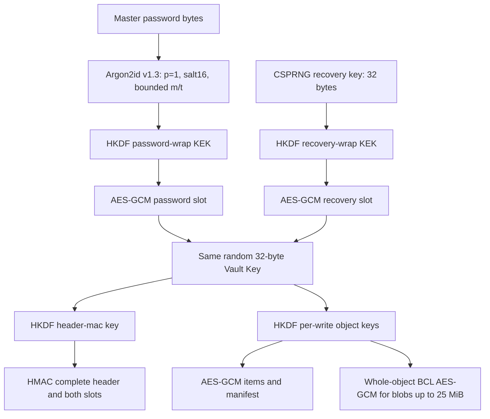

# Recovery, KDF and plaintext boundaries — SN-002 draft

Status: SN-002-R2, 2026-11-12. Two independent slots and mandatory recovery in M1 are
Accepted in [ADR 0007](adr/0007-recovery-key-slots.md). Detailed CLI UX remains a specification;
KDF worker/hard deadlines below are explicitly unapproved engineering options.
Exact crypto encodings are in
[vault format](vault-format.md); commits use [storage protocol](storage-protocol.md).
CLI spellings below are proposed contracts, not implemented commands.

## Key hierarchy and credential lifecycle

VK and RK are independently sampled from OS-backed CSPRNG. RK is never derived from a
password, stored in plaintext in the vault, embedded in logs or retained in an ordinary
session after its operation. Neither password nor RK is needed after authenticating VK
unless its corresponding slot must be replaced. No server, escrow or security questions.

| Operation | Required input | Atomic result / recovery invariant |
|---|---|---|
| Init | New password, verified delivery of new RK | Both slots, authenticated empty manifest and root published together; no password-only intermediate vault |
| Password change | Authenticated password session, confirmed new password | Fresh password slot; recovery slot copied byte-for-byte; same VK and objects |
| Lost password | RK + complete authentic vault/backup | Recovery unlock, new confirmed password slot, retained recovery slot; full validation before commit |
| Lost RK, password known | Password reauthentication | New independent RK, verified delivery/acknowledgement, new recovery slot; password slot unchanged |
| Replace RK | Fresh authentication by either credential | New RK acknowledged before replacing recovery slot; never a slotless committed state |
| Delete recovery | Any | Refused in v1; replace rather than remove |
| Suspected credential exposure | Valid credential + owner-directed full rekey | New VK, epoch, both slots, all items/blobs/manifest re-encrypted; not merely slot replacement |

Before publication, read the candidate root back from its staged bytes. For init and
full VK rotation, independently unwrap **both** slots with their confirmed credentials
and compare the recovered VK to the candidate VK in constant time; verify the header MAC
through each route. For single-slot replacement perform this check on the new slot and
require the unchanged slot to be byte-identical to the previously authenticated root.
A delivery acknowledgement alone does not prove that a recovery slot was wrapped correctly.
On failure retain the old root; init remains unpublished.

Mutating credentials requires fresh authentication, not just an unattended unlocked UI.
A recovery-unlocked session replacing RK must also establish a known new password before
commit if the old password is unavailable. Password change may leave a compromised RK
active; explain this rather than silently rotate it. Credential rotation failure preserves
the old root and leaves no partially changed slots.

A full VK rotation needs a supplied existing RK **or** delivery/acknowledgement of a new
RK to wrap the new VK, and a supplied/confirmed password to build the password slot.
Knowing VK does not let the application rewrap a slot whose credential it does not know.
Re-encrypt all active item/blob files into a fresh epoch, preserve logical IDs/revisions/
timestamps for unchanged content, but regenerate every write ID and cryptographic random
value. No old-epoch object may be referenced from the new manifest. Old roots/backups keep
the old epoch and credentials. Do not chain the old VK into the new header.

Slot replacement is access management for the new header, **not cryptographic revocation**.
Anyone who saved an old slot/header and its credential may recover the unchanged VK and
decrypt later objects from that epoch. New VK prevents that specific future-data access,
but cannot revoke knowledge of old data, stop compromised hosts or erase old snapshots.
Old backups remain decryptable with their old password/RK; a newly generated RK does not
unlock an old backup. Document which vault/epoch/generation a recovery artifact accompanies.
If both credentials are lost, or all authentic roots/wrapped VK are lost, recovery is not
possible. If only ciphertext is lost, neither credential reconstructs it.

## Recovery text and delivery

RK contains 32 uniform random bytes (256 bits). Canonical text is `SN1-` followed by
12 groups of five uppercase characters, separated by hyphens. The 60 characters are:
RFC 4648 uppercase Base32(RK), no `=` padding (52 characters), followed by Base32 of the
first five bytes of SHA256(D("recovery-check") || RK), without padding (8 characters).
The last RK base32 symbol has four zero padding bits; reject noncanonical nonzero padding.
This is a 40-bit typo checksum, not authentication or a password KDF. The full token has
75 ASCII characters (4 prefix + 60 data + 11 separators). Vault ID, epoch and creation
context are printed as a separate nonsecret label, never confused with the key itself.

Input accepts ASCII lowercase by uppercasing, and removes ASCII space/tab/CR/LF and
hyphens **after** recognizing the SN1 prefix. No Unicode folding, O/0 or I/1 aliases.
Bound raw input to 256 bytes, require exactly 60 decoded symbols, verify checksum in
constant time before attempting recovery slot. Format/checksum errors do not echo input.
Copy/paste/export emits canonical format. A checksum cannot prove storage or correct vault.

Interactive `nook init`: read/confirm password via no-echo TTY; create candidate in private
staging, display RK only on explicit recovery screen on the controlling terminal, warn
about terminal recording and storage separate from vault/backup. Ask user to re-enter the
**complete RK** with no echo, verify, then commit and report success. Do not place RK in
stdout/stderr logs or clipboard. Cancellation before acknowledgement does not publish a
vault. A user can choose a protected file instead of screen display with the same check.

Noninteractive init: require distinct explicit input handles for password and a dedicated
`--recovery-out <new-file>` destination plus `--acknowledge-recovery-file` (nonsecret
acknowledgement flag). Create the file exclusively with owner-only permissions, outside
vault/staging and no symlinks/reparse points; flush, close, reopen safely, verify exact RK
round-trip, then publish vault. The caller explicitly assumes responsibility for preserving
that artifact; software cannot prove an independent offline backup. No default RK stdout,
JSON field, environment variable or implicit overwrite. If an unattended workflow cannot
supply these guarantees, fail rather than initialise without recovery. A process can
instead use the interactive two-step confirmation; a mere `--yes` is insufficient.

If delivery succeeds but commit fails, keep the external recovery artifact (never delete
user-designated output automatically), return a failure and explain that vault creation was
not confirmed. Do not reuse candidate secrets for an unrelated init. Reopen/authenticate
an ambiguous root before deciding whether a retry is needed. RK replacement follows the
same delivery-before-commit protocol; an uncommitted new key never revokes the existing one.

## KDF policy and denial-of-service limits

Keep ADR 0002's Argon2id v1.3, p=1, salt16, output32, minimum 64 MiB and t=3.
[Argon2 RFC 9106](https://www.rfc-editor.org/rfc/rfc9106) is background; its p=4 test
vector is not a drop-in vector for NSec's p=1/no-secret/no-AD API. Use exact parameters
and an independent reference implementation in [V02](SN-002-VERIFICATION.md).

Wire ceilings are m=1 GiB, t=10; validate them before native calls. Local automatic budget
is min(256 MiB, one quarter of currently available physical RAM), rounded down to MiB;
if below 64 MiB, refuse password KDF. Memory observations are estimates, not allocation
guarantees. Explicit per-operation budget increases may reach the 1 GiB wire ceiling;
never take budget consent from the vault file. A larger saved m is not silently reduced:
ask for a compatible trusted device/local budget, or allow explicit RK recovery.

The calibration working target is 0.5–1 second. Evaluate m=64,128,256,512,1024 MiB
within an explicitly approved local budget at t=3, then increase t up to 10. Prefer memory
before passes and use synthetic inputs, warmup and repeated measurements. This search and
the 256 MiB/default available-RAM heuristic above require validation on representative
hardware; neither a target latency nor format ceilings prove a hard execution deadline.
If even the minimum is slow, retain m64/t3 or fail with a resource error, never downgrade.
Persist exact m/t, not latency; devices opening an existing vault must use its exact values.

**Not approved or implemented:** a killable KDF worker, a 10-second attempt deadline,
30-second maximum/total calibration deadline and their IPC/lifecycle. These are retained
as engineering options from the original draft, not requirements adopted by ADR 0007/0008.
Before any hard-deadline promise, separately decide the mechanism, permission/memory model,
AOT deployment and secret cleanup and verify it on each platform. A Task timeout does not
cancel a native Argon2 call. Do not claim cooperative cancellation of that call.

One attempt at a time; no background retries/all-slot probing. Check parameter and local
memory bounds before invoking KDF. OOM/native failure aborts, wipes surviving buffers,
leaves the vault untouched and never retries with cheaper parameters. Pending cancellation
prevents publication after native completion; if a later approved mechanism terminates
execution, test its cleanup separately. RK avoids Argon2 but still validates the full root.

Upgrades are explicit credential-authenticated slot replacements with fresh salt/ID/nonce,
never auto-rewrites during unlock. Do not raise costs on a device that cannot restore them.
Downgrades within format minimums require explicit risk acknowledgement; below-minimum
values are forbidden. KDF changes preserve the independently usable recovery slot.

## Secret input, output and export

Master password: interactive no-echo input and confirmation for creation/change. Encode
valid Unicode exactly as UTF-8; no trimming or normalisation. For scripts, accept a
restricted inherited handle/pipe with a bounded frame `LE32(byteLength)||bytes`, length
1..1,024, strict UTF-8, no framing newline. RK input uses the same LE32-length framing with 1..256 ASCII bytes, followed by the recovery text parser. Separate channels for password, RK, payload and
acknowledgement; do not multiplex implicit stdin roles. A path/handle number may appear in
argv; secret contents may not. Environment variables and command-line password values
are rejected. Never offer a silent password-file fallback with unsafe permissions.

Default `ls/show --json` returns an allowlist of id/type/revision/title/tags and safe
operation status after full authentication. Do not serialize entire DTOs and remove a
few known secret fields. Usernames, URLs, notes, private/public keys and attachment contents
require `--reveal` or a dedicated explicit export; JSON also requires explicit reveal.
Metadata remains sensitive; escape terminal controls and do not log titles by default.
`nook gen` remains the existing explicit request for generated-secret stdout.

stdout carries requested data or safe machine-readable status only. stderr carries
redacted diagnostics/progress; no credentials, plaintext, raw failed JSON, byte dumps or
secret-bearing exception text. On failure JSON is a single safe error object with stable
category; no partly written JSON document or prior secret output. Exact numeric vault CLI
exit-code mapping is deferred to its CLI contract; existing CLI codes are unchanged here.

Exports: authenticate the complete selected record/blob into bounded RAM before creating
output. Blob v1 uses one AES-GCM tag, exact length/EOF and context/manifest validation,
not streaming-prefix acceptance. Plan for separate plaintext and ciphertext buffers
(up to 50 MiB payload arrays for a 25 MiB blob) plus runtime/metadata overhead. No ArrayPool
is required initially. Admission limits and OOM/cancellation tests must cover concurrent
operations; explicitly wipe owned sensitive buffers on every exit path. Require an explicit destination, exclusive create, no overwrite by default.
For replacement require an explicit overwrite decision, same-directory private temp,
flush and supported atomic replacement; an existing destination remains on failure before
publication. POSIX files0600/directories0700; Windows protected DACL for current user and
required trusted system principals, never inherited broad access. Verify restrictions
before writing bytes, refuse unsupported permissions/filesystems. No filename traversal,
symlink/reparse following or alternate-stream destination. Do not infer paths from stored
originalName. File/SSH/age stdout export is unsupported in M1/M2: even authenticated bytes
can be partially delivered on a broken pipe, and there is no atomic-output rollback.

After authentication, a deliberate file export creates plaintext outside the vault. Its
private temp may survive a crash; report/clean identified owned temps safely on next run,
never claim secure erase on SSD/CoW/snapshots. No pre-authentication plaintext temps exist.
On cancellation before publication, close/remove owned staging output and wipe buffers;
after publication report that export occurred, not that cancellation undid it. All error
paths wipe known mutable buffers via CryptographicOperations.ZeroMemory; prevent ToString,
logging and accidental DTO dumps. .NET/native/OS copies, GC strings and swap remain limits.
